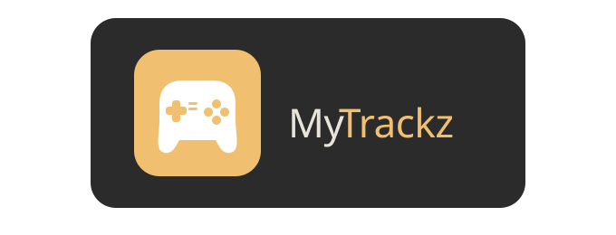
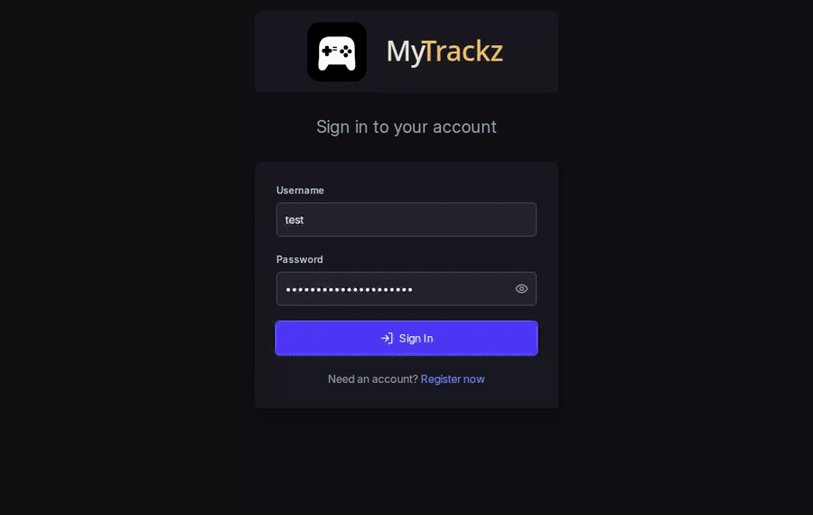
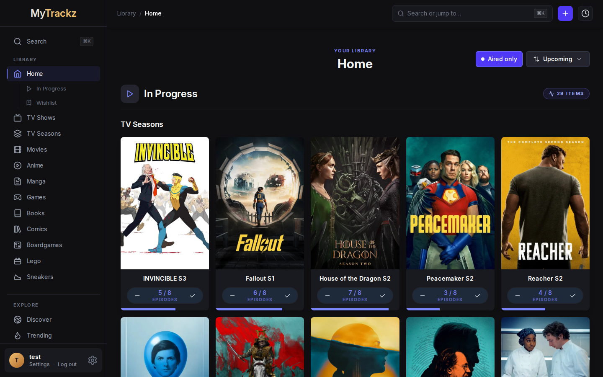
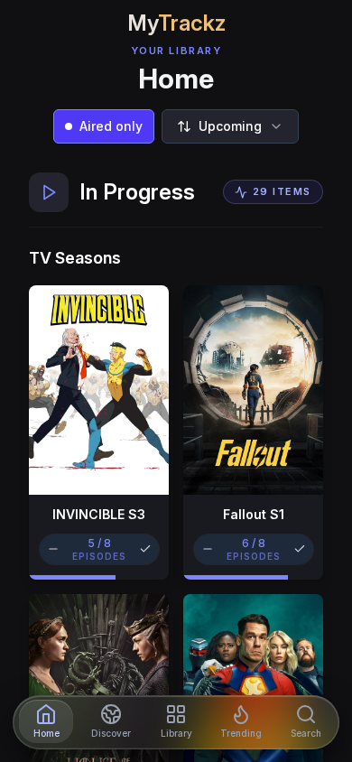
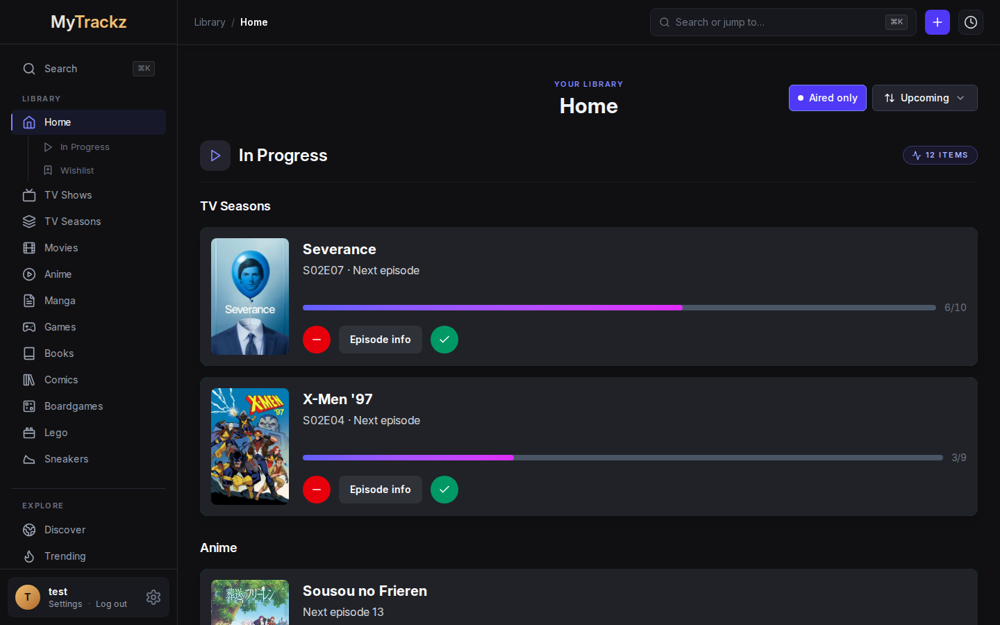
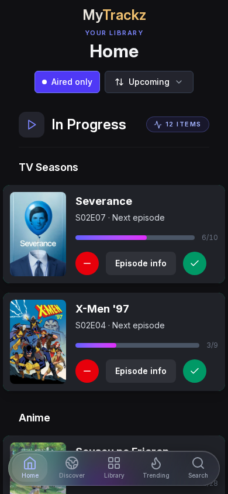
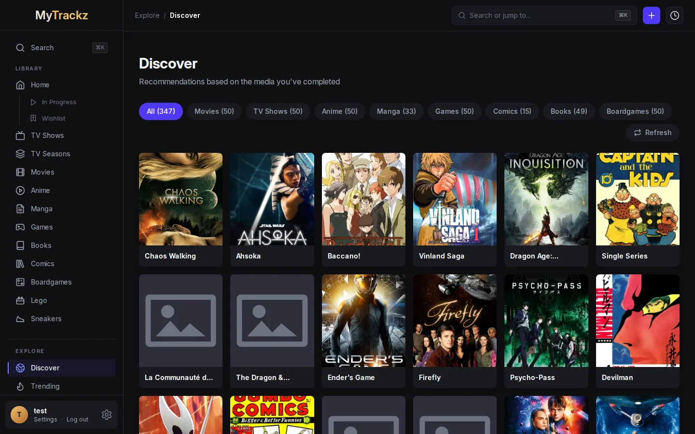
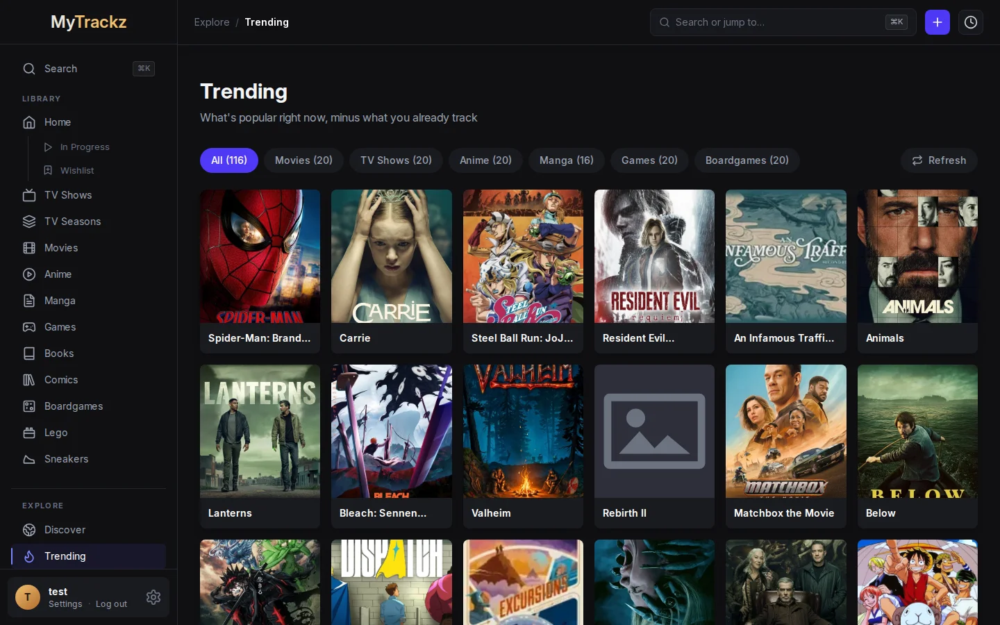

<p align="center">
  
</p>

<!-- --8<-- [start:docs-index-intro] -->

<p align="center">
  <strong>Your watchlist, bookshelf, backlog, and play history—together.</strong>
</p>

<p align="center">
  <a href="LICENSE"></a>
</p>

MyTrackz is a self-hosted tracker for everything you watch, read, play, build, and collect. You get one place for your progress, history, and wishlist across ten categories:

> 🎬 Movies · 📺 TV shows · 🌸 Anime · 📖 Manga · 🎮 Video games · 📚 Books · 💥 Comics · 🎲 Board games · 🧱 LEGO sets · 👟 Sneakers

It syncs with your media server, imports from the services you already use, suggests what to try next, and runs on your own hardware with Docker.

<!-- --8<-- [end:docs-index-intro] -->

<p align="center">
  <a href="#screenshots">Screenshots</a> ·
  <a href="#documentation">Documentation</a> ·
  <a href="#features">Features</a> ·
  <a href="#quick-start">Install</a>
</p>

<a id="screenshots"></a>

## 📱 Screenshots

| Desktop home | Mobile home |
| :-----------: | :---------: |
|  |  |

| Grid dashboard | Mobile grid view |
| :------------: | :--------------: |
|  |  |

| List dashboard | Mobile list view |
| :------------: | :--------------: |
|  |  |

| Discover | Trending |
| :------: | :------: |
|  |  |

<a id="documentation"></a>

## 📚 Documentation

- [Environment variables](docs/env-variables.md) — API keys, sign-in, storage, and runtime settings
- [Administration](docs/administration.md) — backups, maintenance, and day-to-day operation
- [Media imports](docs/media-imports.md) — supported services and how imports behave
- [Social authentication](docs/social-auth.md) — OAuth and identity-provider setup
- [Development](docs/development.md) — local setup, testing, and contributing

<!-- --8<-- [start:docs-index-body] -->

<a id="features"></a>

## ✨ Features

### 📝 Track everything

- **Detailed progress** — status, score, progress, repeats, start and finish dates, and notes for every entry.
- **Episodes and seasons** — follow each TV season on its own and mark episodes as watched.
- **Full history** — a timeline of additions, progress, completions, rewatches, and rereads.
- **Custom entries** — add anything a metadata provider doesn't have.
- **Lists** — personal or shared lists, with other members invited to contribute.
- **Release calendar** — grid or list view, plus a personal iCalendar link for your calendar app.
- **Statistics** — activity heatmap, status and score breakdowns, and tracking history.

### 🏠 A home screen that fits you

- **Grid or compact layout** — poster grids, or a swipeable list with episode details and one-tap progress.
- **Your order** — drag media rows into the order you want; the sidebar follows. A Custom sort lets you arrange items within a row too.
- **Aired-only rows** — caught-up shows step aside until the next episode airs.
- **Interactive cards** — quick actions for completion, lists, and history right on the poster.
- **Expanded rows** — load everything automatically, or keep a "Load all" button for big libraries.
- **Mobile-first design** — a liquid-glass navigation bar and an installable PWA with an offline page.
- **Ten themes** — Dark, Grey and Midnight, plus seven colour palettes: Beachfront, Pumpkin Spice, Tropical Punch, Watermelon Splash, Cotton Candy Skies, Pastel Garden and Lush Forest. Light palettes switch the whole app to dark text. A swatch strip under the Theme picker shows what each colour paints before you save, and every theme is checked for readable text contrast.
- **Command palette** — press <kbd>⌘K</kbd> or <kbd>/</kbd> anywhere to jump straight to a title.

### 🧭 Find what's next

- **Discover** — personalized recommendations drawn from what you track and finish, mixed across media types.
- **Continue the Story** — sequels, next volumes, expansions, and remasters for things you've finished or are in the middle of.
- **Trending** — popular titles from TMDB, MyAnimeList, IGDB, and BGG, minus anything already in your library.
- **Streaming availability** — see where a movie or show is streaming in your region.

### 🗂️ Control your library

- **Filters that stick** — filter by genre, format, game launcher, or LEGO theme without losing your search, sort, or layout.
- **Live counts** — totals update as you search and filter.
- **Edit in place** — change or delete an entry without a page reload or losing your scroll position.
- **Custom artwork** — swap any poster for your own image and restore the original with one click. Set a profile picture with a crop tool.
- **Local image cache** — artwork is saved as small WebP files on your server, with a size cap you choose.
- **Your words** — call your planning list a Wishlist or a Backlog, and set your own date, time, and week formats.

### 🎮 Games

- **Launchers** — tag each game with Steam, GOG, Epic, EA, Ubisoft, Blizzard, Xbox, Nintendo, PlayStation, Emulation, Rockstar, Amazon, or Other.
- **Ownership** — mark games as owned (🎮) or not yet bought (🛒); the badge shows on every cover.

### 🧱 LEGO

- **Rebrickable catalog** — search by name or set number, including brand-new sets.
- **Set details** — set number, year, piece count, theme, and cached artwork.
- **Build time** — log build progress in 30-minute steps; it counts in your history and statistics.
- Works out of the box with a bundled [Rebrickable](https://rebrickable.com/api/) key, or set your own with `REBRICKABLE`.

<a id="sneaker-catalog"></a>

### 👟 Sneakers

- **KicksDB search** — find pairs by name or style code. Details and photos are saved once and stay available offline.
- **Your collection** — pairs owned, status, wishlist, notes (condition, last worn), and history.
- **Original MSRP** — enter the verified launch price and currency yourself; any retail figure from the API is shown separately.
- Set `KICKSDB_API` to enable search. Saved sneakers and custom entries work without a key.

### 🔌 Connect and import

- **Media-server sync** — track playback automatically from [Jellyfin](https://jellyfin.org/), [Plex](https://plex.tv/), and [Emby](https://emby.media/), including Plex DVR recordings. Duplicate webhooks are ignored; real rewatches are kept.
- **Imports** — [Trakt](https://trakt.tv/), [Simkl](https://simkl.com/), [MyAnimeList](https://myanimelist.net/), [AniList](https://anilist.co/), [Kitsu](https://kitsu.app/), IMDb, Goodreads, HowLongToBeat, and Steam, with optional scheduled imports.
- **CSV export and import** — take your whole library with you, game and sneaker fields included.
- **Notifications** — release alerts through [Apprise](https://github.com/caronc/apprise) to Discord, Telegram, ntfy, Slack, email, and more, one at a time or as a daily digest.
- **Sign-in options** — OIDC and 100+ social providers through [django-allauth](https://allauth.org/).

### 🛡️ Run your own instance

- **Guided setup** — a walkthrough for new accounts, with API keys entered and saved in the app.
- **Admin page** — the first account is the admin. Manage accounts, reset passwords, check worker, Redis, and database health, and run scheduled tasks on demand. Set `REGISTRATION=False` once your account exists unless you want open sign-ups.
- **Automatic backups** — a daily, verified copy of the database (SQLite or PostgreSQL) plus a CSV of every library, kept for a week, with optional alerts. See [Backups](docs/administration.md#backups).
- **Housekeeping** — a weekly cleanup removes catalog entries nobody uses, so the database and image cache stay lean.
- **Cache controls** — see image-cache usage and clear the image or search cache from the Admin page.
- **Demo-safe** — demo accounts can't change anything shared by every user.

<a id="quick-start"></a>

## 🐳 Quick start

You need Docker (with the Compose plugin) and Git.

**1. Clone the repository**

```bash
git clone https://github.com/RichardFelix/MyTrackz.git
cd MyTrackz
```

**2. Configure**

Open `docker-compose.yml` and review `TZ` and any API keys you want to use. Common ones:

| Setting | What it does |
| --- | --- |
| `TZ` | Your time zone |
| `URLS` | Public address, if you run behind a reverse proxy |
| `REBRICKABLE` | Your own LEGO search key (optional) |
| `KICKSDB_API` | Enables sneaker search |
| `SECRET` | Optional; a secret key is generated on first start and kept in `db` |

Every option is listed in [Environment variables](docs/env-variables.md).

**3. Start**

```bash
docker compose up -d --build
```

Open [http://localhost:8000](http://localhost:8000). Your SQLite database lives in `./db`, media files in `./media`, and backups in `./backups`.

### Using PostgreSQL

SQLite works well for most personal setups. For PostgreSQL, start from `docker-compose.postgres.yml` and have it build MyTrackz locally:

```yaml
services:
  yamtrack:
    build: .
    image: yamtrack:local
```

Change the example database passwords, then start it:

```bash
docker compose -f docker-compose.postgres.yml up -d --build
```

## 🙏 Credits

MyTrackz began as a fork of [Yamtrack](https://github.com/FuzzyGrim/Yamtrack) by [FuzzyGrim](https://github.com/FuzzyGrim), whose tracking core it still builds on. Thank you.

MyTrackz's own features were designed and built with [Claude Code](https://claude.com/claude-code) and [Codex](https://openai.com/codex/).

Licensed under the [GNU Affero General Public License v3.0](LICENSE).

<!-- --8<-- [end:docs-index-body] -->
